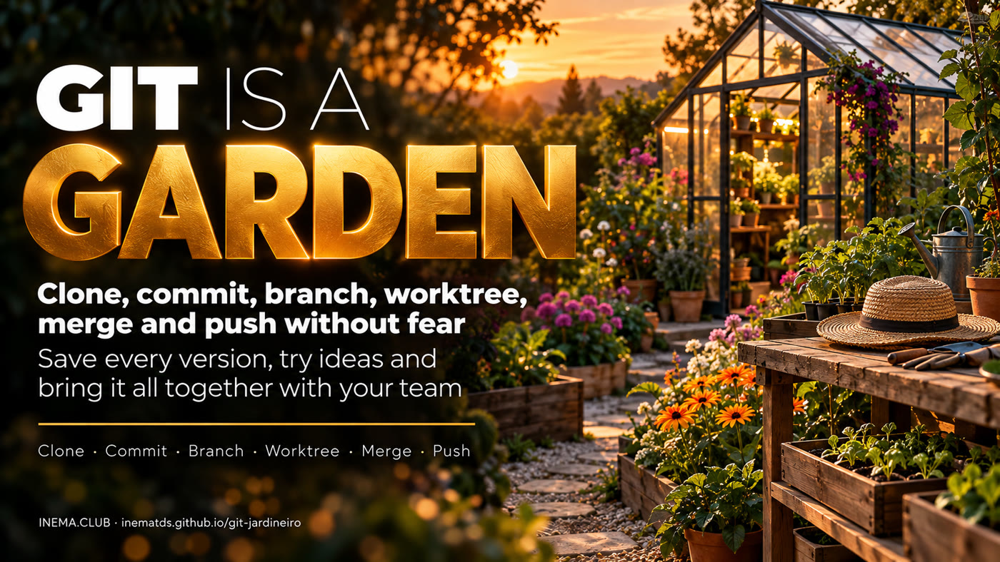

# Git is a garden

**🇧🇷 [Português](README.md) · 🇺🇸 [English](README.en.md) · 🇪🇸 [Español](README.es.md)**

## What it is

This free guide explains Git through the story of a gardener. Git is a tool that keeps every version of a project, like photos of a garden taken over time. It is useful for people who program, people who work with AI agents, and anyone who wants to stop losing files. Here you will learn six commands (clone, commit, branch, worktree, merge, and push), each with a drawing, a simple explanation, and commands ready to copy. To practice, you just need to have Git installed.

## 📖 Guide

Full guide (landing + 6 explainer pages): **https://inematds.github.io/git-jardineiro/guia/en/**

## The 6 steps

1. **Clone** — Bring the garden home: Clone copies the project and its entire history to your computer. (https://inematds.github.io/git-jardineiro/guia/en/clone/)
2. **Commit** — Take a photo of the garden: Edit, choose what to include, and take the photo. The commit saves it on your computer. (https://inematds.github.io/git-jardineiro/guia/en/commit/)
3. **Branch** — Try a new idea: A branch is a label that moves along with your new commits. (https://inematds.github.io/git-jardineiro/guia/en/branch/)
4. **Worktree** — Two flower beds at the same time: A worktree is another folder for the same project, open on another branch. (https://inematds.github.io/git-jardineiro/guia/en/worktree/)
5. **Merge** — Bring the changes together: Merge brings two histories together in a new commit. (https://inematds.github.io/git-jardineiro/guia/en/merge/)
6. **Push** — Share with the team: Push sends your commits to the remote. Now the team can get them. (https://inematds.github.io/git-jardineiro/guia/en/push/)

| | |
|---|---|
| `git clone <url> garden` | bring the project and its history to your computer |
| `git status` | see what changed and what is in the staging area |
| `git add .` | put the changes in the staging area |
| `git commit -m "frase"` | take the photo: save the version on your computer |
| `git switch -c flowers` | create the flowers label and work on it |
| `git worktree add ../garden-main main` | open another folder, on another branch |
| `git merge flowers` | bring the flowers branch into the current branch |
| `git push origin main` | take your photos to the greenhouse |
| `git fetch` | download the greenhouse's new history without joining it |
| `git pull` | download and join it into your branch |

## Editing the guide

Text lives in `src/<lang>.json`; HTML is generated by `python3 src/build.py`.

Free projects and courses: https://inema.club
